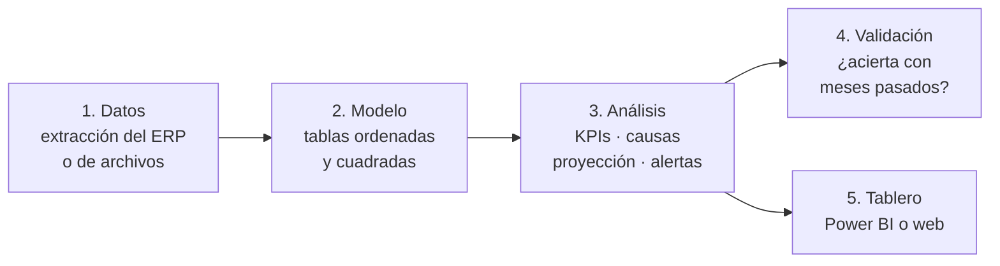

# Guía: cómo implementar este sistema de control presupuestario en una empresa

Esta guía explica **cómo construimos** este proyecto y el de [control presupuestario en retail](https://github.com/tomasmoyaaraya/control-presupuestario-retail),
pensada para llevarlo a un trabajo real. No hace falta saber programar a nivel experto, pero sí entender el negocio.

---

## 1. Qué resuelve

Cada mes, alguien en control de gestión compara lo **real** con el **presupuesto** y tiene que responder:

| Pregunta | Qué entrega el sistema |
|---|---|
| ¿Cuánto nos desviamos? | Indicadores contra el presupuesto y contra el año anterior |
| ¿Por qué? | Un puente (cascada) que separa la desviación en sus causas |
| ¿Dónde miro primero? | Alertas automáticas por área, tienda, centro de costo, etc. |
| ¿Cómo vamos a cerrar? | Una proyección del cierre con su error medido |

La idea central: **todo se calcula con reglas explícitas y repetibles**, no a mano en una planilla distinta cada mes.

---

## 2. Las cinco piezas

Cada pieza es un archivo separado que se corre en orden. Si algo falla, se sabe en qué paso fue.

| Pieza | En este proyecto | En una empresa típica |
|---|---|---|
| Datos | `descargar.py` (portal de datos abiertos) | Exportación del ERP (SAP, Softland, Defontana…) o archivos que envían las áreas |
| Modelo | `modelo.py` + `sql/vistas.sql` (SQLite) | Base de datos de la empresa, SQLite, o el modelo de Power BI directamente |
| Análisis | `analisis.py` (Python) | Python, o medidas DAX si todo vive en Power BI |
| Validación | función `validar()` en `analisis.py` | Lo mismo: probar con meses o años pasados |
| Tablero | `docs/index.html` y `powerbi/` | Power BI, que es lo que más se usa en Chile |

---

## 3. Paso a paso para llevarlo a tu trabajo

### Paso 0 · Definir las preguntas antes de tocar datos
- ¿Qué decisiones se toman con este informe y quién las toma? (gerencia, jefes de área, directorio)
- ¿Contra qué se compara? Presupuesto, año anterior, forecast.
- ¿Cuál es la unidad de análisis? Tienda, centro de costo, proyecto, línea de negocio.
- ¿Cada cuánto? Normalmente mensual, con un vistazo a mitad de mes.

> Error común: construir el tablero primero y descubrir después que no responde lo que la gerencia pregunta.

### Paso 1 · Conseguir los datos mínimos
Con estas tres tablas se puede hacer casi todo:

| Tabla | Columnas mínimas | Ejemplo |
|---|---|---|
| **Real** | fecha (o año-mes), unidad (tienda/centro de costo), cuenta o categoría, monto | Ventas y gastos del libro mayor o del ERP |
| **Presupuesto** | año-mes, unidad, cuenta o categoría, monto presupuestado | La planilla de presupuesto anual |
| **Maestros** | código de la unidad, nombre, zona/área, responsable | Listado de tiendas o centros de costo |

Si se quiere separar precio y volumen, hace falta además **cantidad** (unidades) en real y presupuesto.

**Antes de seguir, cuadrar:** el total real del mes debe coincidir con el estado de resultados contable. En este proyecto
comprobamos que la suma de los 12 meses daba exactamente el acumulado anual oficial. Si no cuadra, nadie va a confiar
en el tablero.

### Paso 2 · Ordenar los datos (modelo)
- Una tabla de **hechos** (los montos) conectada a tablas de **dimensiones** (tiempo, unidades, cuentas). Es el
  "esquema estrella", el mismo que usa Power BI.
- Normalizar nombres y códigos: los archivos cambian de formato entre meses o años (columnas con otro nombre,
  separadores distintos, códigos que cambian). Aquí tuvimos los tres problemas.
- Excluir lo que no es gestión: aquí sacamos las operaciones financieras y las cuentas del Tesoro. En una empresa
  pueden ser las transferencias entre filiales o los ajustes contables de cierre.

### Paso 3 · Análisis
1. **KPIs:** real, presupuesto, diferencia en pesos y en %, y lo mismo contra el año anterior. Siempre año a la fecha
   con **meses cerrados** (un mes a medias parece una caída).
2. **Causas (puente):** separar la desviación de venta en *precio* y *volumen y mix*:
   - efecto precio = (precio real − precio presupuestado) × unidades reales
   - efecto volumen y mix = desviación total − efecto precio
   Los gastos entran cuenta por cuenta. Los gastos que dependen de la venta (comisiones, mermas) se comparan como
   % de la venta (**presupuesto flexible**), no en pesos.
3. **Proyección de cierre:** lo acumulado hasta hoy ÷ la fracción que normalmente se lleva a esta fecha. Esa
   fracción sale de la historia de la propia unidad (mediana de los últimos años o del mismo mes del año anterior).
4. **Alertas:** reglas simples y escritas de antemano. Ejemplos usados:
   - gasto más de 20% sobre el presupuesto **y** atípico frente a las demás unidades (z-score robusto > 3);
   - venta bajo 92% del presupuesto 3 meses seguidos;
   - cierre proyectado bajo 90% del presupuesto.
   Marcar como **recurrente** lo que se repite, para separar el ruido de los problemas reales.

### Paso 4 · Validar antes de mostrar
Esta es la parte que casi nadie hace y la que da credibilidad:
- **Probar con el pasado sin hacer trampa:** proyectar cada mes o año anterior usando *solo* la información que
  existía en ese momento, y comparar con lo que pasó.
- **Compararse con una regla tonta** (repetir el año anterior, proyección lineal). Si el método no le gana, no aporta.
- **Fijar los parámetros antes** de mirar el resultado (umbrales, meses de historia). Si se ajustan hasta que "dé
  bien", el resultado deja de valer.
- **Decir los números como son:** aquí la proyección detecta 76% de los casos, pero 46% de sus alertas no se cumplen.
  Eso se informa; no se esconde.

### Paso 5 · Tablero
Reglas de diseño (estándar IBCS), que hacen que el informe se lea igual siempre:
- **Título con el mensaje**, no solo con el tema: "El EBITDA está 9% bajo el presupuesto por menores precios", no "EBITDA".
- **Real en gris oscuro, presupuesto en gris claro o contorno, proyección rayada o discontinua.**
- **Color solo para las desviaciones:** verde favorable, rojo desfavorable. Nada de colores decorativos.
- Pocas páginas: resumen → causas → alertas.
- Las cifras del tablero deben ser **exactamente** las del análisis. Aquí lo comprobamos medida por medida.

### Paso 6 · Rutina mensual
1. Llega el cierre contable → actualizar los datos (correr los scripts en orden o "Actualizar" en Power BI).
2. Revisar la cuadratura con contabilidad.
3. Leer las alertas recurrentes y pedir explicación a los responsables.
4. Escribir el mensaje del mes (2 o 3 líneas) y enviar el tablero.
5. Una vez al año, revisar si las reglas siguen acertando (repetir la validación).

---

## 4. Errores que cometimos (para no repetirlos)

| Error | Qué pasó | Cómo evitarlo |
|---|---|---|
| Elegir un filtro mirando todos los datos | En el proyecto cripto, la validación quedó contaminada | Separar los datos de prueba y no tocarlos hasta el final |
| Mezclar denominadores | La curva histórica usaba un presupuesto y la proyección otro | Medir todo contra la misma base y escribirlo en el gráfico |
| Confiar en la cifra oficial | El "99% de ejecución" se mide contra un presupuesto ya recortado | Preguntar siempre "¿contra qué se compara este %?" |
| Mostrar el mes en curso como cerrado | Un mes a medias parecía una caída de ventas | Separar meses cerrados de la proyección |
| Formatos que cambian | Los archivos traían columnas distintas según el año | Normalizar al leer y validar totales |
| Publicar rutas del computador | El proyecto de Power BI guardaba la carpeta personal | Revisar los archivos antes de publicar; las rutas locales fuera del repositorio |

---

## 5. Cómo trabajamos (con un asistente de IA)

El proyecto se hizo con Claude Code, por fases y con aprobación en cada una:
1. **Explicar antes de construir:** qué se va a hacer, con qué datos y qué riesgos tiene. Recién ahí construir.
2. **Revisar datos reales antes de prometer:** antes de elegir el proyecto se comprobó que los datos existían y se podían descargar.
3. **Verificar cada número:** cuadraturas, comparación contra otra fuente y validación con el pasado.
4. **Herramientas conectadas:** el servidor MCP de Power BI permitió probar las medidas DAX directamente contra el
   modelo abierto, en vez de revisarlas a ojo.
5. **Honestidad en el informe:** cada README incluye una sección de "qué no debes creer de este proyecto".

---

## 6. Antes de usarlo con datos de una empresa

- **Los datos de la empresa no van a un repositorio público.** Usar un repositorio privado o la carpeta compartida de
  la empresa, y respetar la política de confidencialidad.
- **Revisar qué se publica:** rutas de carpetas, nombres de personas, montos reales, credenciales de bases de datos.
- **Pedir autorización** antes de conectar herramientas externas (incluida la IA) a sistemas o datos de la empresa.
- **Anonimizar** si se quiere mostrar el trabajo en un portafolio: cambiar nombres y escalar montos.
- **Documentar** las reglas y los parámetros para que otra persona pueda mantener el sistema.
