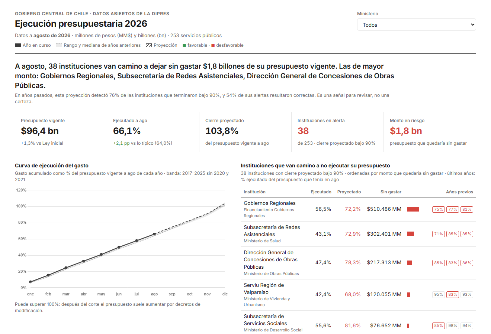
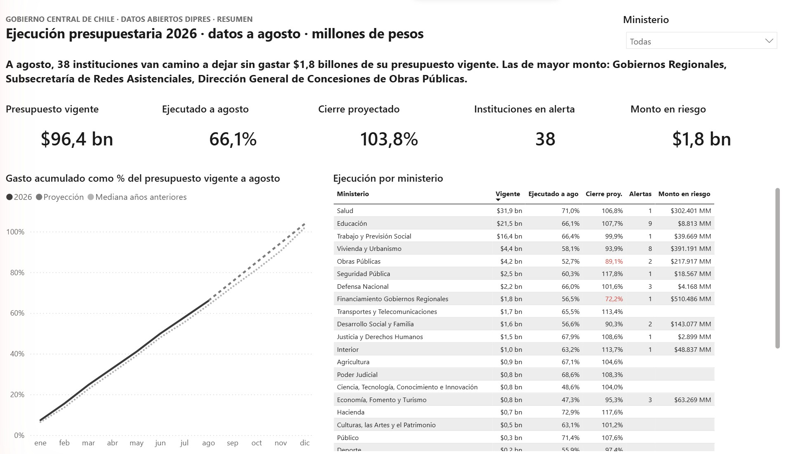
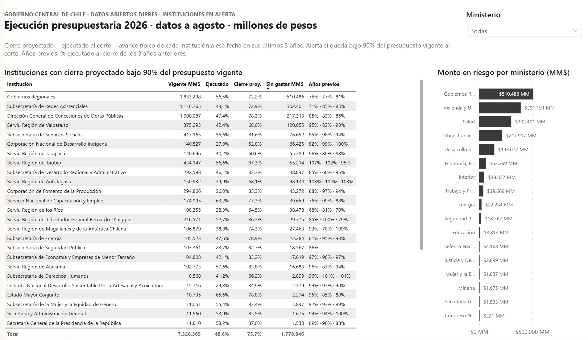
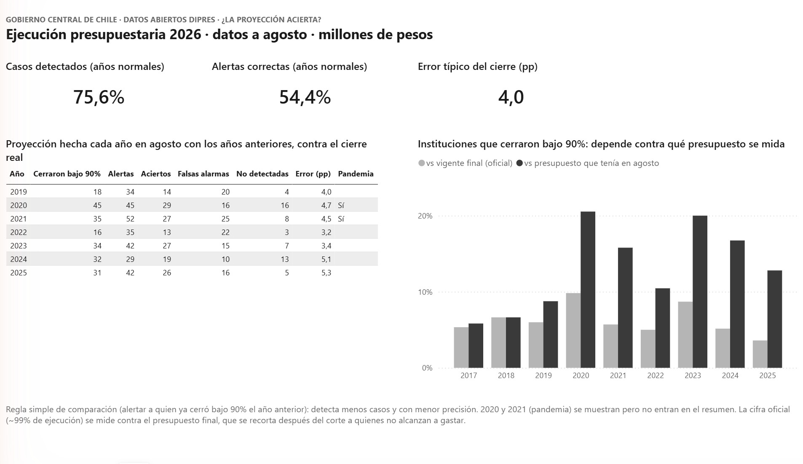

# ¿Quién no alcanzará a gastar su presupuesto? Ejecución presupuestaria del Estado de Chile

Seguimiento de la ejecución presupuestaria del **Gobierno Central de Chile** con datos **oficiales y públicos** de la
Dirección de Presupuestos (DIPRES), desde 2017 hasta agosto de 2026: 298 servicios públicos, mes a mes.

**[Ver el tablero web en vivo](https://tomasmoyaaraya.github.io/ejecucion-presupuestaria-chile/)** · [Informe en Excel](resultados/informe_ejecucion.xlsx) · [Proyecto de Power BI](powerbi/)

> Los datos son oficiales. El análisis, las proyecciones y las alertas son míos, no de la DIPRES.



---

## De qué trata

Cada año el Congreso aprueba la **Ley de Presupuestos**: cuánto puede gastar cada ministerio y cada servicio público.
Durante el año ese presupuesto se va modificando, y cada mes la DIPRES publica cuánto lleva gastado cada institución.

Que una institución no gaste su presupuesto no es una buena noticia: suele significar obras que no avanzaron,
programas que no llegaron a la gente o compras que se atrasaron. Y como el año fiscal termina el 31 de diciembre,
lo que no se gastó a tiempo se pierde o se reasigna.

En el sector público, el control de gestión hace cada mes las mismas preguntas que en una empresa:

1. **¿Cuánto llevamos ejecutado** y es normal para esta fecha?
2. **¿Quién va atrasado?**
3. **¿Cómo vamos a cerrar el año?**

## Qué quería averiguar

> **En agosto, con cuatro meses por delante, ¿se puede anticipar qué instituciones no van a ejecutar su presupuesto?**

A diferencia de un proyecto con datos inventados, aquí la respuesta se puede comprobar con la realidad: tengo los
años 2017 a 2025 completos. Así que para cada año hice la proyección "como si estuviera en agosto de ese año", usando
**solo la información disponible en ese momento**, y después la comparé con lo que realmente pasó en diciembre.

## Cómo lo hice, paso a paso

**1. Descargar los datos** (`descargar.py`).
El programa consulta el portal de datos abiertos del Estado (datos.gob.cl) y descarga, para cada mes desde 2017, dos
archivos oficiales: cuánto gastó cada servicio y cuál era su presupuesto (el aprobado al inicio y el vigente a esa
fecha). Son 232 archivos, y no se necesita ninguna clave. Los archivos cambian de formato entre años (nombres de
columna, separadores, un `;` sobrante al final de algunas filas), así que el programa los normaliza.

**2. Ordenar los datos** (`modelo.py`, `sql/vistas.sql`).
Uní gasto y presupuesto en una base de datos, por servicio, tipo de gasto y mes. Para medir el gasto real de cada
servicio dejé fuera las operaciones financieras (compra de bonos, pago de deuda) y las cuentas del Tesoro Público, que
no son gasto de un servicio. Comprobé que los datos cuadran: la suma de los doce meses da exactamente el acumulado
anual que informa la DIPRES.

**3. Analizar** (`analisis.py`).
- **¿Cuánto se ejecuta?** Contra el presupuesto inicial, contra el vigente a agosto y contra el vigente final.
- **¿Es normal el ritmo?** La curva de gasto mes a mes de cada año y cuánto se concentra en diciembre.
- **¿Cómo cerrará cada institución?** Una proyección simple: si una institución suele llevar el 55% de su gasto anual a
  fines de agosto y hoy lleva $100, se proyecta que cerrará en $100 ÷ 0,55 = $182. El "suele" es la mediana de sus
  últimos tres años.
- **Alertas:** se marca a quien, según esa proyección, cerrará bajo el 90% de su presupuesto.

**4. Comprobar si funciona.** Repetí la proyección para cada año entre 2019 y 2025 usando solo los años anteriores, y
la comparé con el cierre real. También la comparé con una regla más simple, para saber si la proyección aporta algo.

**5. Mostrar los resultados** (`docs/`, `powerbi/`).
Un tablero web con filtro por ministerio y un informe de Power BI con las mismas cifras, ambos con el estándar de
reportes de gestión IBCS (lo actual en oscuro, la historia en gris y el color solo para lo que está mal o bien).

## Qué encontré

**1. El 99% oficial esconde la subejecución.**
Cada año el Estado reporta haber ejecutado cerca del 99% de su presupuesto. Pero ese porcentaje se calcula contra el
presupuesto *final*, que se recorta a fin de año a quienes no alcanzan a gastar. Si se mide contra el presupuesto que
cada institución tenía en agosto, el panorama cambia:

| Año | Instituciones bajo 90% (cifra oficial, vs presupuesto final) | Instituciones bajo 90% (vs presupuesto que tenían en agosto) |
|---|---|---|
| 2023 | 8,7% | **20,0%** |
| 2024 | 5,2% | **16,7%** |
| 2025 | 3,6% | **12,8%** |

**2. La proyección anticipa la mayoría de los casos, pero no es infalible.**
En los cinco años normales probados (2019 y 2022 a 2025):

| | Proyección | Regla simple: alertar a quien ya quedó bajo 90% el año anterior |
|---|---|---|
| Casos detectados | **76%** (99 de 131) | 57% |
| Alertas que resultaron correctas | **54%** (99 de 182) | 49% |
| Error típico del cierre proyectado | **4,0 puntos** | 7,3 puntos con una proyección lineal |

Le gana a la regla simple en todo, pero **casi la mitad de las alertas no se cumple**: es una señal para revisar, no un veredicto.

**3. En 2026, a agosto, 38 instituciones van camino a dejar sin gastar $1,8 billones.**
Las de mayor monto son los Gobiernos Regionales ($510 mil millones), la Subsecretaría de Redes Asistenciales de Salud
($302 mil millones) y la Dirección General de Concesiones de Obras Públicas ($217 mil millones). Varias repiten el
patrón de años anteriores: Redes Asistenciales cerró 2023 al 71% del presupuesto que tenía en agosto.

**4. El gasto se concentra a fin de año.** A fines de agosto, el Estado lleva entre el 61% y el 65% de su gasto anual (un
ritmo parejo daría 67%), y diciembre concentra alrededor del 13%. En algunos servicios, más de un tercio del gasto del año
ocurre en diciembre.

## Límites y qué no debes creer de este proyecto

- **No sé por qué se recorta el presupuesto.** Un recorte después de agosto puede ser un ahorro, una reasignación
  deliberada o un problema de ejecución. Los datos muestran *que* pasa, no *por qué*.
- **Los totales no son el gasto oficial del Estado.** Sumo el gasto de cada servicio sin descontar las transferencias
  entre servicios, así que algunas platas se cuentan dos veces. Sirve para comparar a cada institución con su propio
  presupuesto, no para citar "el Estado gastó X".
- **Los parámetros los fijé yo**: el umbral de 90%, los tres años de historia y el mínimo de $1.000 millones de
  presupuesto para entrar en el análisis. Los definí antes de correr la validación y no probé otras combinaciones
  para mejorar el resultado, pero son decisiones mías.
- **Las instituciones nuevas o reestructuradas no tienen historia propia** (por ejemplo, el Ministerio de Seguridad
  Pública, creado en 2025): para ellas se usa el ritmo típico de todo el Estado, que es menos preciso.
- **2020 y 2021 se excluyen del resumen** por la pandemia (fondos de emergencia, gasto atípico). Sus resultados se
  muestran igual en la tabla de validación.
- **Montos en pesos nominales**, sin ajustar por inflación, y sin los presupuestos en dólares (menos del 3% de los registros).

## Power BI

El proyecto se genera por código (`powerbi/generar_pbip.py`) en formato `.pbip`: modelo semántico con 24 medidas DAX
(la curva mensual y los indicadores se calculan en DAX sobre los datos mensuales) y un informe de tres páginas. Las
medidas las verifiqué contra los resultados de Python con el servidor MCP de Power BI.

| Resumen | Alertas |
|---|---|
|  |  |



## Cómo reproducirlo

```bash
pip install pandas numpy openpyxl
python descargar.py              # ~90 MB desde datos.gob.cl (queda en caché en datos/crudos/)
python modelo.py                 # presupuesto.db
python analisis.py               # resultados/informe_ejecucion.xlsx
python exportar_dashboard.py     # docs/data.js (tablero web)
python powerbi/generar_pbip.py   # powerbi/Ejecucion.pbip (abrir con Power BI Desktop y pulsar Actualizar)
```

Cuando la DIPRES publique un mes nuevo, basta con volver a correr los cinco pasos.

El último paso también crea el archivo con la ruta de los datos en tu computador (parámetro `CarpetaDatos`
del modelo de Power BI), que no se publica en el repositorio. Por eso hay que correrlo antes de abrir el `.pbip`.

**Glosario rápido**
- **Ley de Presupuestos inicial:** lo que aprobó el Congreso para el año.
- **Presupuesto vigente:** el inicial más las modificaciones hechas durante el año por decreto.
- **Ejecución:** lo efectivamente gastado (devengado).
- **Servicio o institución:** cada "capítulo" de la Ley de Presupuestos (por ejemplo, un SERVIU regional o una subsecretaría).
- **Punto porcentual (pp):** diferencia entre dos porcentajes (de 60% a 64% hay 4 pp).

---

Hecho por [Tomás Moya Araya](https://github.com/tomasmoyaaraya), ingeniero civil industrial. Ver también el
[proyecto de control presupuestario en retail](https://github.com/tomasmoyaaraya/control-presupuestario-retail).
